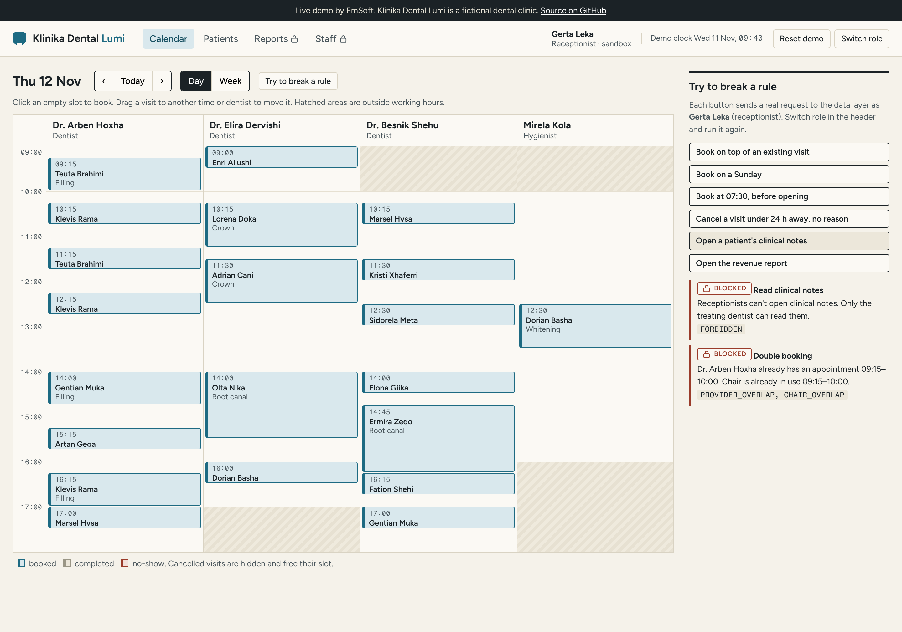
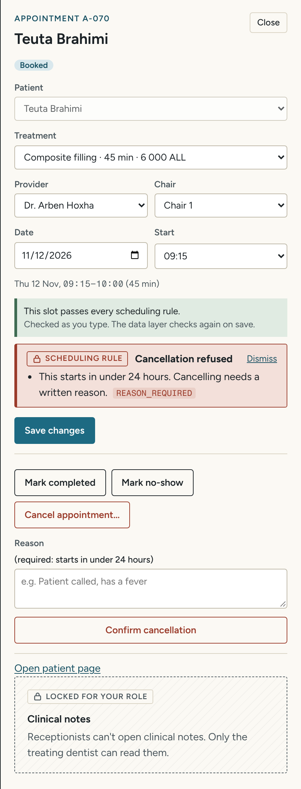
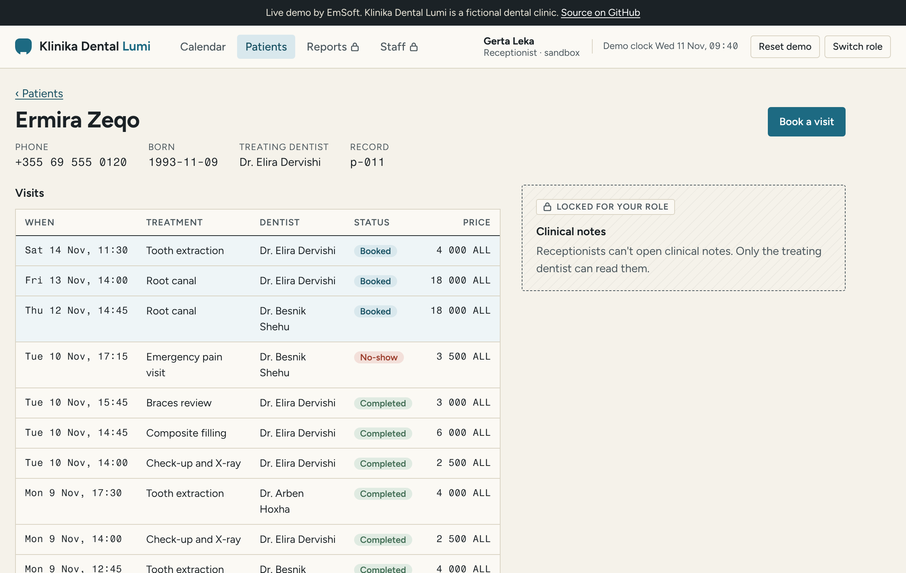
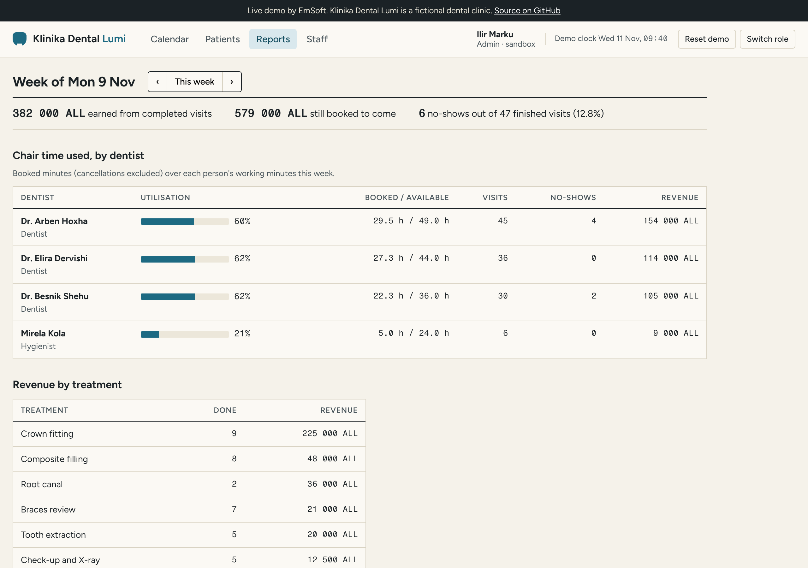
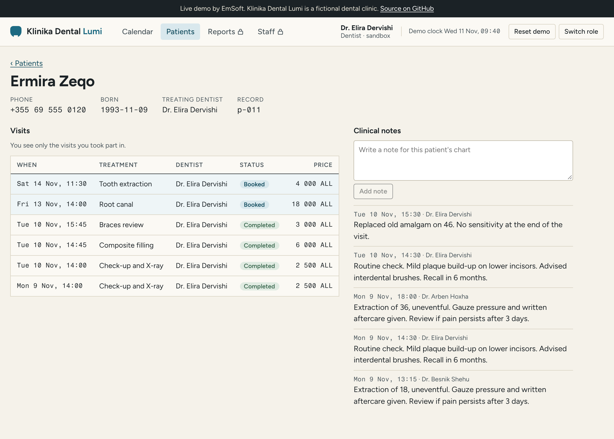
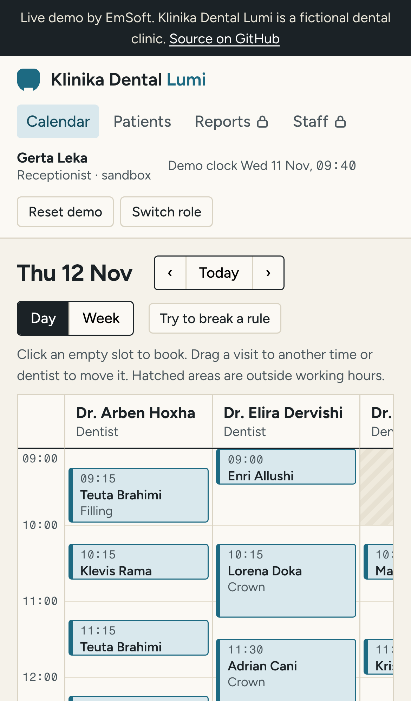

# Clinic bookings dashboard: a role-based Next.js + Supabase app

A clinic that runs bookings on paper and WhatsApp needs one calendar, staff logins, and rules that stop mistakes. This is a working MVP for a fictional dental clinic: receptionists book, dentists see only their own day, the admin sees reports, and the permission rules are enforced in code and in the database.

**▶ Live demo: https://enxo7899.github.io/clinic-dashboard/** (click "Sign in as Receptionist", then "Try to break a rule")



## What it does

| Capability | Detail |
|---|---|
| Calendar by dentist | Day and week view for 3 dentists and 1 hygienist. Click a slot to book, drag a visit to move it. |
| Roles | Admin, receptionist, dentist. Each sees and does only what the clinic allows. |
| Appointment drawer | Treatment (with duration and price in ALL), provider, chair, time. Live rule check while you type. |
| Patients | List with next and last visit, patient page with visit history. |
| Clinical notes | Written and read only by the treating dentist. Everyone else gets a visible "locked" message. |
| Admin reports | Chair utilisation per dentist, no-shows, revenue this week. Computed from the appointments. |
| Staff management | Admin switches staff on or off. A dentist with upcoming visits can't be switched off. |
| Sandbox login | Three buttons, no passwords. Data lives in your browser; "Reset demo" restores it. |

## The rules, and where they are enforced

The rules are in [`src/lib/rules.ts`](src/lib/rules.ts) as pure functions. The demo data layer calls them on every write. For a real deployment, [`supabase/migrations`](supabase/migrations/20260101000000_schema.sql) repeats them as row level security, exclusion constraints and triggers, so the database refuses a bad write even if someone bypasses the screen.

| Rule | In code | In the database |
|---|---|---|
| Receptionists create, move and cancel visits; dentists can't | `can()` | RLS insert/update policies plus a trigger |
| Receptionists and admins never read clinical notes | `canReadNotes()` | `notes` select policy returns zero rows |
| Dentists see only their own schedule and patients | `canSeeAppointment()`, `isOwnPatient()` | `appts_read`, `patients_read` policies |
| Dentists write notes only for their own patients | `canWriteNotes()` | `notes_insert` policy |
| Admin only: reports and staff | `can()` | admin-only staff policies |
| No overlap per dentist, per chair, per patient | `checkAppointment()` | `EXCLUDE USING gist` constraints |
| Working hours, days off, Saturday until 13:00 | `workingWindow()` | `appointments_guard` trigger |
| Hygienists don't get root canals | `TREATMENT_NOT_OFFERED` | same trigger |
| Cancelling under 24 hours needs a reason | `checkCancellation()` | same trigger |

The demo clock is fixed at Wed 11 Nov 2026, 09:40, so the 24-hour rule behaves the same for every visitor.

<p>



</p>
<p>


</p>

## Run it

```bash
npm ci
npm test            # 38 tests: rules, demo data layer, report maths, seed in sync
npm run dev         # http://127.0.0.1:5180/clinic-dashboard/  (sandbox demo)
npm run build       # static export in out/ (basePath /clinic-dashboard for GitHub Pages)
npm run screenshots # after a build; regenerates docs/*.png
```

Open any screen as a role with `?as=receptionist`, `?as=dentist` or `?as=admin`, for example `/clinic-dashboard/calendar/?as=dentist&date=2026-11-12`.

### Point it at a real Supabase project

1. Create a project at supabase.com and open the SQL editor.
2. Run `supabase/migrations/20260101000000_schema.sql`, then `supabase/seed.sql`. (`npm run seed:sql` regenerates the seed from `src/lib/seed.ts`. Dates are relative to the week you run it.)
3. In Authentication, add a user for each staff member.
4. Link each login to a staff row: `update staff set auth_user_id = '<auth user uuid>' where email = 'gerta@lumi.example';`
5. Copy `.env.example` to `.env.local` and fill `NEXT_PUBLIC_SUPABASE_URL` and `NEXT_PUBLIC_SUPABASE_ANON_KEY` (the anon key is safe in the browser; RLS is what protects the data).
6. `npm run dev` or `npm run build`. With both variables set, the app uses `SupabaseAdapter` and shows an email and password form instead of the sandbox buttons.

Test the database side on a throwaway local Postgres (needs `psql` and the `PG*` environment variables pointing at an empty database):

```bash
npm run test:db     # applies the migration and seed, then tries to break every rule as each role
```

The live demo never uses Supabase. Both adapters implement one interface ([`src/lib/adapter.ts`](src/lib/adapter.ts)), so the screens don't change.

## Adapt it to your business

- `src/lib/seed.ts`: staff, chairs, treatments, prices and opening hours. Run `npm run seed:sql` after editing.
- `src/lib/rules.ts`: the notice period, hours and permission matrix. Change the matching trigger or policy in the migration.
- Other clinics (physio, vet, salon): rename treatments and roles. The calendar, rules and reports carry over.

## Honest limits

- The demo stores data per browser and uses a fixed clock. It proves the logic and the screens, not multi-user sync.
- Drag to move uses native drag and drop, which doesn't work on touch screens. On a phone, tap a visit and change the time in the drawer.
- Supabase mode has been checked at the database level (`npm run test:db`, local Postgres 16) but the browser adapter has not been run against a hosted project.

---
Built by **[EmSoft](https://github.com/enxo7899)**: web apps and automations for small businesses, from first screen to live demo. Get in touch through my Fiverr or Upwork profile.
